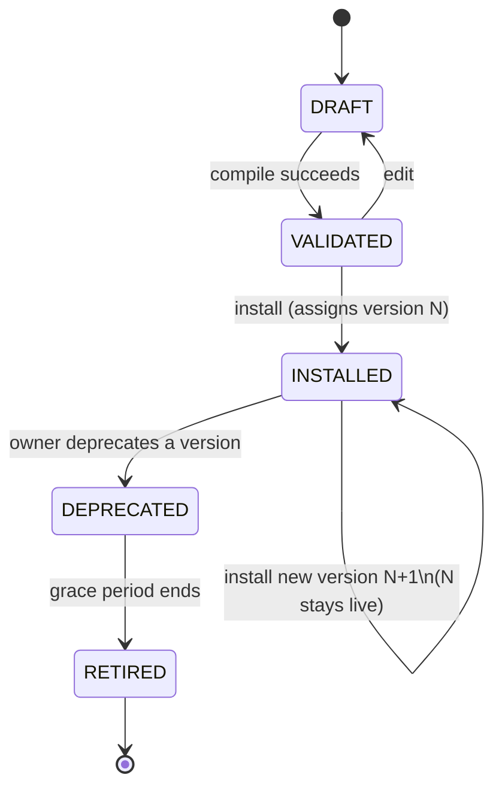
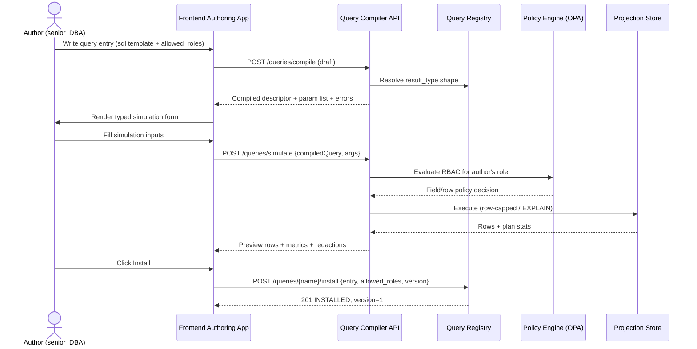
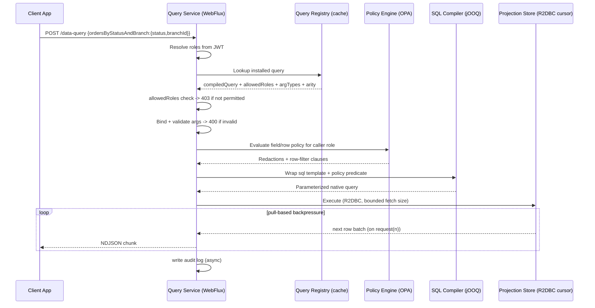
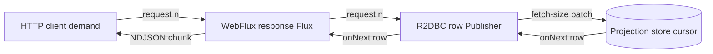

# Policy-Compiled Query DSL Service — Implementation PRD

Oct 7, 2026 · @Anirudhya Sarker

## Relationship to the Read Engine PRD

[Generic Query Service (Read Engine) — PRD](Generic%20Query%20Service%20%28Read%20Engine%29%20%E2%80%94%20PRD.md) already chose the **policy-compiled query DSL** approach and defined its core contract: a JSON query AST (`from`/`select`/`where`/`orderBy`/`page`), a compiler that turns that AST into native store queries, and an OPA/Rego policy layer that redacts fields and rows at compile time. That PRD's Phase 1 ("Foundation") is "a single projection queryable end to end, no RBAC yet."

This PRD is the concrete design for that foundation phase, specifically the workflow the team walked through: how an author **defines and simulates** a query before anyone can call it, and how an installed query is **invoked** by a client app at runtime over a reactive stream. It does not revisit the approach decision — it assumes the Read Engine PRD's own JSON AST (for ad hoc `/query` calls) and OPA policy layer, and adds the pieces that document was silent on: the authoring/installation lifecycle for named, installed queries, the `allowed_roles` gate's place in the RBAC model, and the Java/reactive backend design.

## Assessment of the proposed design

| # | Concern in the original proposal | Recommendation |
| --- | --- | --- |
| 1 | The query body is shown as hand-written SQL (`SELECT ... FROM ... WHERE ...`). Raw SQL can't be safely compiled with field/row redaction, can't be cost-limited, and reopens the injection and unbounded-scan risks the prior PRD explicitly ruled out as non-goals. | The `sql` field stays a template, never a string built at runtime: arguments are written as `:argName` and bound through the driver's native named-parameter binding, which closes the injection risk without a full SQL-to-AST translation. The template is the executable query itself — RBAC composes around it (derived-table wrap for row-level, post-fetch redaction for field-level) instead of inside a parsed `where` tree. See "Query definition format" below. |
| 2 | `@Allow` reads as the only RBAC mechanism, but the prior PRD already defines field- and row-level ABAC via OPA/Rego. Two unreconciled RBAC layers invite confusion about which one governs what. | Make `allowed_roles` (the YAML field carrying the `@Allow` idea) the **coarse, operation-level gate**: can this role invoke this installed query at all? It composes with, not replaces, the existing field/row policies, which still apply to every row and field the query touches regardless of who's allowed to call it. |
| 3 | No versioning or immutability. Editing an installed query in place can silently break every client app that already depends on it. | Installed queries are immutable per version. Edits produce a new version; the registry tracks which version is "current," and callers can pin a version or float to latest. |
| 4 | Simulation runs real queries against real projection data with no stated limits — a bad `WHERE` clause during a demo can trigger a full scan. | Simulation reuses the same compile-time cost limiter from the Read Engine PRD (row cap, timeout, `EXPLAIN` instead of full execution where possible) and requires the same `allowed_roles`-equivalent authoring privilege, not open access. |
| 5 | No arity enforcement for `-> Order[]` vs `-> Order`. Nothing stops a query declared as "single" from matching many rows. | The compiler enforces declared arity: a `SINGLE`-arity query is compiled with an implicit `LIMIT 2` and the service returns `409` if more than one row matches, rather than silently returning the first row. |
| 6 | No namespacing — `queryName` collisions across teams/bounded contexts are likely once this is self-service. | Installed queries are namespaced by their owning module file (e.g. `orders_sql.yml` → `orders.ordersByStatusAndBranch`), matching the projection registry's existing ownership model with no separate namespace field to keep in sync. |
| 7 | Large list responses as a single buffered JSON array fight the stated goal of reactive streaming with backpressure — the server still has to hold the whole array (or at least its framing) open. | Stream list results as newline-delimited JSON (NDJSON), one row per `onNext`, so the HTTP response body never requires buffering beyond what backpressure already allows. |

## Query lifecycle



## Query definition format (YAML)

Reassessing the grammar-based DSL from the previous revision of this PRD: it bought compile-time validation of column/table references at the cost of a hand-rolled parser the Query Registry engine would have to own and maintain. **For now, we adopt a flatter format instead.** Each bounded context's queries live in a `{module}_sql.yml` file, one YAML list of correlated query entries; a query's `sql` field is the templated SQL itself, with arguments written as `:argName` — the same named-parameter convention JDBC/R2DBC drivers already bind natively. This drops the custom grammar and the SQL→AST translation step entirely: the registry engine's "compiler" shrinks to extracting `:paramName` tokens from the template and checking them against the declared `arg_types`.

```yaml
- name: a_query_name
  # example SQL string:
  #   SELECT projection_a, projection_b, projection_c
  #   FROM a_table
  #   WHERE colA = :arg1 AND colB = :arg2
  sql: a_sql_string
  arg_types:
    arg1: a_data_type
    arg2: another_data_type
  result_type: { Structure[] | Structure }
  allowed_roles: Role[]
```

A concrete module file, `orders_sql.yml`, grouping two correlated queries owned by the orders bounded context:

```yaml
# orders_sql.yml
- name: ordersByStatusAndBranch
  sql: >
    SELECT orderId, status, total, branchId
    FROM order_projection
    WHERE status = :status AND branchId = :branchId
  arg_types:
    status: String
    branchId: int
  result_type: Order[]
  allowed_roles: [senior_DBA, chief_DBA]

- name: orderById
  sql: >
    SELECT orderId, status, total, branchId
    FROM order_projection
    WHERE orderId = :orderId
  arg_types:
    orderId: String
  result_type: Order
  allowed_roles: [senior_DBA, chief_DBA, support_agent]
```

`queryName` is now `{moduleFile}.{name}` — `orders.ordersByStatusAndBranch` — which gives namespacing (Assessment, #6) for free from the file layout, with no separate namespace field to keep in sync.

### What the registry engine actually builds

There is no AST in the Read Engine PRD's sense (a `from`/`select`/`where` tree) for an installed query anymore. Loading a module file produces, per entry, a lightweight `CompiledQuery` descriptor:

```json
{
  "queryName": "orders.ordersByStatusAndBranch",
  "sql": "SELECT orderId, status, total, branchId FROM order_projection WHERE status = :status AND branchId = :branchId",
  "params": [
    { "name": "status", "type": "STRING" },
    { "name": "branchId", "type": "INT" }
  ],
  "returns": { "shape": "Order", "arity": "LIST" },
  "allowedRoles": ["senior_DBA", "chief_DBA"]
}
```

Building it is three steps, none of which parse SQL:

1. Scan `sql` for `:identifier` tokens with a regular expression.
2. Cross-check the token set against `arg_types` — a token with no declared type, or a declared type never used in `sql`, is a load-time error for that module file.
3. Resolve `result_type` to a registered output shape (`Order`) and arity (`[]` or none).

| `arg_types` value | Java/R2DBC binding |
| --- | --- |
| `String` | `java.lang.String` |
| `int` | `int` |
| `long` | `long` |
| `decimal` | `java.math.BigDecimal` |
| `boolean` | `boolean` |
| `date` | `java.time.LocalDate` |
| `datetime` | `java.time.Instant` |
| `enum(A, B, ...)` | generated Java enum, validated against the listed values |

### Trade-off: what this format gives up

The grammar-based approach resolved `FROM`/column references against the projection registry at compile time — an unknown column was a load-time error. Treating `sql` as an opaque template drops that check: a typo in a column name now only surfaces when the query actually runs — still at simulate time, before install, so nothing broken reaches a client, it just moves the failure one step later in Phase 1.

### RBAC composition over a templated SQL string

Because `sql` is text the registry engine doesn't parse, the Read Engine PRD's field- and row-level OPA policies can't be spliced into a `where` tree anymore. They compose at two different points instead:

- **Row-level**: the templated SQL is wrapped as a derived table, and the OPA-generated predicate is applied as an outer filter — `SELECT * FROM (<templated sql>) q WHERE <policy predicate>` — rather than being merged into the template's own `WHERE` clause. The policy predicate may only reference columns present in `result_type`, which the registry validates when the policy is authored.
- **Field-level**: the template always selects its full declared column set; redaction happens by omitting disallowed fields from the response payload after the row is fetched, not by rewriting the `SELECT` list text. This costs a little efficiency (the store still computes the redacted column) but avoids string surgery on a SQL template, and keeps the redaction logic identical to the Read Engine PRD's.

---

## Phase 1 — Query Definition & Simulation (design-time)

**Actors**: Author (e.g. `senior_DBA`, `chief_DBA`), Frontend authoring app, Query Compiler API, Query Registry, Policy Engine (OPA), Projection Store.

**Precondition**: the author holds an authoring role for the target projection, separate from (and typically a superset of) any role listed in the query's own `allowed_roles`.

**Steps**:

1. Author writes the query entry — `name`, templated `sql`, `arg_types`, `result_type`, `allowed_roles` — either directly in a module file or through a frontend editor that edits the equivalent YAML entry.
2. Frontend sends the draft entry to `POST /queries/compile`. The registry engine extracts `:paramName` tokens from `sql`, checks them against `arg_types`, and resolves `result_type` into a registered output shape — no SQL parsing or column resolution happens here.
3. Compiler returns the `CompiledQuery` descriptor (sql template, param list, resolved return shape/arity) and any load-time errors (an undeclared or unused parameter, an unknown `result_type`). Errors stop the flow here — nothing executes yet.
4. Frontend renders a simulation form generated from `arg_types` (`status: String`, `branchId: int`, …).
5. Author fills in sample values and submits `POST /queries/simulate` with the compiled descriptor and the args.
6. Compiler evaluates the OPA policy for the author's own role (same enforcement point as live traffic) — wrapping `sql` with the row-level predicate described above — then executes it against the projection store under the cost limiter (row cap, timeout, or `EXPLAIN`-only).
7. Backend returns preview rows, performance metrics (latency, rows scanned, plan cost), and any fields the author's own role would have redacted — so the author sees exactly what a real caller with that role would see.
8. Author iterates (edit → recompile → resimulate) until satisfied, then clicks **Install**. Frontend sends `POST /queries/{queryName}/install` with the final entry, `allowed_roles`, declared return shape, and owning module. The registry assigns a version, marks it `INSTALLED`, and publishes a registry-changed event so invocation nodes refresh their cache.



### Example JSON

`POST /queries/compile`

```json
{
  "module": "orders",
  "name": "ordersByStatusAndBranch",
  "sql": "SELECT orderId, status, total, branchId FROM order_projection WHERE status = :status AND branchId = :branchId",
  "arg_types": { "status": "String", "branchId": "int" },
  "result_type": "Order[]",
  "allowed_roles": ["senior_DBA", "chief_DBA"]
}
```

Response:

```json
{
  "queryName": "orders.ordersByStatusAndBranch",
  "sql": "SELECT orderId, status, total, branchId FROM order_projection WHERE status = :status AND branchId = :branchId",
  "params": [
    { "name": "status", "type": "STRING" },
    { "name": "branchId", "type": "INT" }
  ],
  "returns": { "shape": "Order", "arity": "LIST" },
  "allowedRoles": ["senior_DBA", "chief_DBA"],
  "errors": []
}
```

`POST /queries/simulate`

```json
{
  "compiledQuery": { "...": "as returned above" },
  "args": { "status": "SHIPPED", "branchId": 12 }
}
```

Response:

```json
{
  "rows": [
    { "orderId": "O-1042", "status": "SHIPPED", "total": 128.50, "branchId": 12 }
  ],
  "rowCount": 1,
  "truncated": false,
  "metrics": { "latencyMs": 18, "rowsScanned": 340, "planCost": 12.4 },
  "redactedFields": []
}
```

`POST /queries/orders.ordersByStatusAndBranch/install`

```json
{
  "compiledQuery": { "...": "final, resimulated descriptor" },
  "allowedRoles": ["senior_DBA", "chief_DBA"],
  "returns": { "shape": "Order", "arity": "LIST" },
  "owner": "orders-context-team"
}
```

Response:

```json
{
  "queryName": "orders.ordersByStatusAndBranch",
  "version": 1,
  "status": "INSTALLED",
  "installedAt": "2026-10-07T10:15:00Z",
  "installedBy": "anirudhya.sarker@bracits.com"
}
```

---

## Phase 2 — Query Invocation (run-time)

**Actors**: Client app, Query Service (Spring WebFlux), Query Registry cache, Policy Engine (OPA), SQL Compiler (jOOQ), Projection Store (R2DBC).

**Precondition**: the query is `INSTALLED`; the caller presents a JWT carrying their role claims.

**Steps**:

1. Client app calls `POST /data-query` with the query name and its arguments. No role is passed in the body.
2. The service resolves the caller's roles from the JWT.
3. The service looks up the installed query's cached `CompiledQuery` descriptor, `allowedRoles` list, argument types, and return arity from the registry cache (refreshed on registry-changed events, not on every request).
4. **Operation-level gate**: if none of the caller's roles appear in `allowedRoles`, return `403` immediately — the query never reaches the compiler.
5. Arguments are validated and bound against the typed schema (never string-concatenated); a mismatch returns `400`.
6. **Row/field-level gate**: the AST and the caller's roles are evaluated against the OPA policy — the same mechanism and enforcement point as the Read Engine PRD — producing redacted fields and injected row-filter clauses.
7. The SQL Compiler wraps the installed `sql` template as a derived table, ANDs in the OPA row-level predicate, and binds the caller's arguments to the `:paramName` placeholders — producing a single parameterized native query. Field-level redaction happens when mapping result rows to the response, not in the generated SQL.
8. The query executes through the reactive store adapter as a cursor: list queries open a `Flux` with a bounded fetch size, single queries open a `Mono`.
9. Results are emitted to the client as they arrive, under backpressure — the HTTP response is streamed as NDJSON for `LIST` arity or a single JSON object for `SINGLE` arity. Redacted-field metadata and the pagination cursor travel as response headers so the body stays a pure, homogeneous stream.
10. An audit entry (caller, role, query, version, rows returned, redactions, latency) is written asynchronously after the stream completes or is cancelled.



### Backpressure path



Demand flows from the HTTP client back through Reactor to the R2DBC driver, which pulls only as many rows from the database cursor as downstream has requested. No layer buffers the full result set; a slow client throttles the database read, not the other way around.

### Example JSON

`POST /data-query`

```json
{
  "ordersByStatusAndBranch": {
    "status": "SHIPPED",
    "branchId": 12
  }
}
```

List response (`Content-Type: application/x-ndjson`, `X-Redacted-Fields`, `X-Next-Cursor` headers), one JSON object per line as it streams:

```
{"orderId":"O-1042","status":"SHIPPED","total":128.50,"branchId":12}
{"orderId":"O-1043","status":"SHIPPED","total":64.00,"branchId":12}
```

Single-object response (`Content-Type: application/json`) for a `SINGLE`-arity query such as `orders.orderById(orderId String) -> Order`:

```json
{ "orderId": "O-1042", "status": "SHIPPED", "total": 128.50 }
```

`403` — operation-level RBAC denial:

```json
{
  "error": "FORBIDDEN",
  "message": "Role 'support_agent' is not permitted to invoke 'orders.ordersByStatusAndBranch'",
  "queryName": "orders.ordersByStatusAndBranch"
}
```

`400` — argument validation failure:

```json
{
  "error": "INVALID_ARGUMENT",
  "message": "branchId expected INT, received STRING",
  "field": "branchId"
}
```

---

## Backend technology recommendation

| Concern | Tool | Why it fits |
| --- | --- | --- |
| Reactive runtime, HTTP streaming, backpressure | **Spring WebFlux on Project Reactor (Netty)** | Native `Flux`/`Mono` end to end; non-blocking I/O from the socket to the database driver; built-in support for streaming NDJSON responses where backpressure is expressed as subscriber demand rather than a buffer size. |
| Wrapping the registry's templated SQL with the OPA row-level predicate and executing it reactively with a cursor | **jOOQ + R2DBC** | jOOQ's plain-SQL templating (`DSL.resultQuery`) takes the registry's `sql` template as a derived table as-is — the author's SQL is never re-parsed — and lets the OPA row-level predicate be ANDed on through jOOQ's typed `.where()`, so the wrapping stays parameterized by construction even though the inner query is opaque text. jOOQ's R2DBC integration returns a `Flux<Record>` that honors the fetch size as the cursor's batch unit, so the same reactive pipeline that drives HTTP backpressure also drives how many rows are pulled from Postgres/MySQL/etc. at a time. |

Both choices share Reactor's `Publisher` contract, so no adapter layer is needed between "how many rows the client has asked for" and "how many rows the database cursor fetches next." A hand-rolled SQL string builder or a blocking JDBC + thread-pool design would need a separate, custom backpressure mechanism to get the same property — and, since the registry's `sql` templates are already opaque text, jOOQ's role here is wrapping and binding them safely, not generating them.

The OPA/Rego policy evaluation introduced in the Read Engine PRD carries over unchanged — evaluate it with the embedded OPA Java/WASM SDK (or a local OPA sidecar) inside the same non-blocking request path, before step 7 above.

## Registry additions

| Field | Type | Notes |
| --- | --- | --- |
| `queryName` | string | `{module}.{name}` — namespaced by owning module file, e.g. `orders.ordersByStatusAndBranch` |
| `module` | string | Owning `{module}_sql.yml` file; combined with `name` gives `queryName` |
| `version` | int | Monotonic per `queryName`; immutable once installed |
| `status` | enum | `DRAFT`, `VALIDATED`, `INSTALLED`, `DEPRECATED`, `RETIRED` |
| `sql` | string | Templated SQL from the module file — the executable query itself, not just a display copy |
| `compiledQuery` | JSON | Lightweight descriptor: `sql` + extracted param list + resolved return shape. No `select`/`where` tree — see "Query definition format" |
| `argTypes` | JSON | `arg_types` map, used for both the simulation form and runtime binding |
| `returns` | `{shape, arity}` | Drives `LIST` (NDJSON) vs `SINGLE` (JSON) response handling and arity enforcement |
| `allowedRoles` | string[] | `allowed_roles` — the operation-level gate |
| `owner` | string | Owning bounded context/team |
| `installedAt` / `installedBy` | timestamp / string | Audit trail |

## Open questions

- [ ] Does `allowed_roles` grant invocation rights outright, or is it itself subject to an approval step before a query moves `VALIDATED → INSTALLED`?
- [ ] Should simulation run against the live projection store or a point-in-time replica, given it's exercised by DBAs experimenting with arbitrary filters?
- [ ] What's the deprecation grace period for an `INSTALLED` version once a newer one exists, and who is notified?
- [ ] Do client apps pin a specific installed version, or always float to the latest `INSTALLED` version of a `queryName`?
- [ ] Should the registry still validate that `FROM`/column names in `sql` resolve against the projection registry at load time, or fully defer to simulate-time execution errors, as this revision proposes?
- [ ] Should authoring tooling lint that an OPA row-level policy only references columns present in `result_type`, so the derived-table wrap can't silently reference a column the template never selects?
- [ ] Is the flat YAML format durable, or is it an interim step back toward a parsed grammar once the registry needs compile-time column validation again?

## Next steps

This PRD fixes the contract (YAML query format, lifecycle, `allowed_roles` semantics, streaming response shape) and the two core backend libraries. The actual implementation plan — milestones, which projection onboards first, how the registry engine and OPA integration get built incrementally — is the subject of the follow-up iterations the team agreed to work through separately, anchored to Phase 1 ("Foundation") of the Read Engine PRD's rollout plan.
